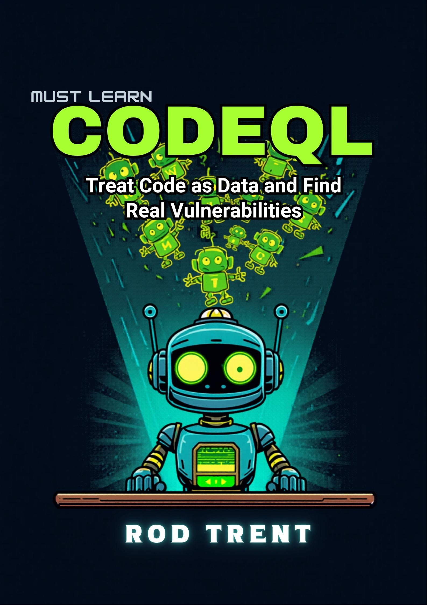

# Must Learn CodeQL

Companion repository for the *Must Learn CodeQL* book by Rod Trent.

## Structure

- `Book_Version/` – The current edition of the book (DOCX) and cover.
- `images/` – Book cover and other assets.
- `examples/` – Runnable CodeQL queries and supporting files, organized by chapter.
  - `chapter01/` … `chapter15/` – Examples referenced in the corresponding book chapter.
- `scripts/` – Helper scripts for database creation and common workflows.

## How to Use

1. Clone this repository.
2. Install the CodeQL CLI and/or the CodeQL extension for Visual Studio Code.
3. Open any `.ql` file under `examples/chapterNN/` and run it against a database (create one with the commands shown in the book or download a public database).

All query examples in the book point to files in this repository so you can locate and run them immediately.

## License

MIT – see LICENSE.